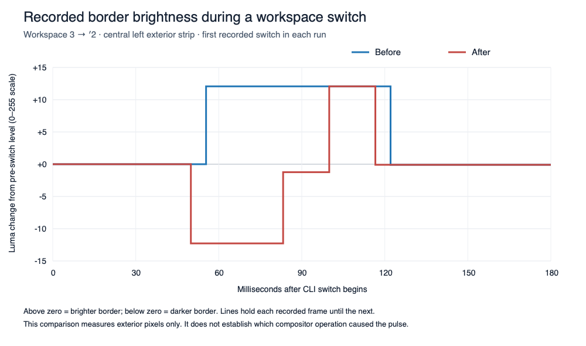

# Native window hiding investigation

Checked on 2026-09-29, on macOS 26.5.1 (25F80), with one Studio Display and one
normal macOS desktop. `csrutil status` reported SIP enabled before and after the
tests.

## Result

Actual per-window hiding works on this machine without disabling SIP. Both
existing private-API implementations removed a disposable window from
WindowServer's on-screen list and restored it without changing its frame.

This establishes feasibility, not a fix for the previous integrated AeroSpace
hover regression. The isolated AppKit test did **not** reproduce that regression.
The installed AeroSpace process and its configuration were left unchanged during
the isolated tests. A subsequent live trial is recorded below.

## What was tested

A separate accessory AppKit process owned a borderless floating window with an
`NSTrackingArea` using `activeAlways`. An external controller, compiled against
the repository's `WorkspaceVisibility.m` and `WorkspaceGroups.m`, moved that
window. AeroSpace did not manage the probe. This isolates the private APIs from
AeroSpace's refresh, activation, and focus scheduling.

| Method | While hidden | After reveal | Hover evidence |
| --- | --- | --- | --- |
| Connection-owned group | Only type-3 group membership; not on screen | Same group; on screen; `isOnActiveSpace == false` | Real pointer movement increased the counter from 133 to 185, with two additional enter/exit pairs, while the group was shown |
| Normal native parking Space | Only parking desktop membership; not on screen | Only original desktop membership; on screen; `isOnActiveSpace == true` | Hover worked after restoration to the original desktop |

The false `isOnActiveSpace` value in the group approach is a compatibility
difference, but it does **not** by itself explain the old hover failure. The
probe continued receiving mouse events in that state. Tracking that depends on
the active app or key window, browser hover, and AeroSpace's focus integration
were not covered by this test.

Additional checks:

- Five automated hide/reveal/restore cycles for each method: all ten passed
  visibility, restored membership, and unchanged-frame assertions.
- Killing the controller while its group was hidden returned the probe to the
  original desktop and made it visible. This verifies that specific
  connection-loss case, not AeroSpace's complete crash recovery.
- A hybrid experiment assigned the window to a hidden group and then called
  `AeroSpaceMoveWindowsToNativeSpace(home)`. Membership became `[group, home]`:
  that call does not detach a type-3 group. Destroying the group removed the
  remaining membership.
- Cleanup removed the probe process and window. The desktop inventory returned
  to its original single desktop; the original AeroSpace process was still
  running.

Probe sources and raw results from this session are in the ignored directory
`.local/native-hiding-investigation/`, including `verification.json` and
`group-confirmation.log`.

## First integration trial design

Start with normal native parking and public focus. That keeps visible windows
on the normal desktop and separates hiding from the experimental early private
activation path. The diagnostic flags for that combination are
`AEROSPACE_NATIVE_WORKSPACE_VISIBILITY=1`, `AEROSPACE_WORKSPACE_GROUPS=0`, and
`AEROSPACE_PRIVATE_FOCUS=0`.

Before enabling this for daily use, test actual AeroSpace workspace switches,
key-window tracking, Zen/Chromium hover, multiple windows of one app, dialogs,
minimization, app activation, and recovery. Both existing backends currently
require one display and one normal desktop before starting; the parking backend
creates its own additional desktop.

Code review also found two paths that need regression tests before relying on
the integration:

- `NativeVisibilityWorker.apply` queues a retired live window back to the home
  desktop, but removes its entry without waiting for that restoration.
- `WorkspaceGroupVisibilityWorker.apply` can return its inactive plan after
  assignments when the prepared focus job is cancelled, without first restoring
  group membership.

The prior hover regression is recorded in commit `6216c2d5`. Independent evidence
for SIP-enabled normal-Space moves is in
[yabai issue #2788](https://github.com/asmvik/yabai/issues/2788).

## Live native-parking trial

The user subsequently requested a trial of normal native parking with public
focus handling. The installed build (`dbe8ec6e`) already contains these options;
no rebuild, installation, or persistent configuration change was required.

The trial saved all five existing window/workspace assignments and layouts,
quit AeroSpace normally, and relaunched the same installed app with the three
flags above. It restored all five assignments and the checkpoint's focused
window. This created one additional normal macOS desktop for parked windows.

Six CLI workspace selections spanning all five occupied workspaces passed:
WindowServer reported every inactive window off screen and the active
workspace's window on screen. The original desktop stayed active throughout.
SIP remained enabled. The user then confirmed that the corner slivers were gone
and input worked normally after being asked to check workspace switching,
hover, scrolling, and typing, particularly in Zen. A subsequent snapshot showed
Zen on screen and the other four managed windows fully hidden.

The native-parking/public-focus combination was left active for that launch.
This successful trial does not isolate whether the earlier regression came from
group visibility, private focus, or their interaction, and does not cover all
window lifecycle and recovery cases listed above.

Trial scripts, launch logs, assignment checkpoint, and `switch-checks.json` are
in `.local/native-hiding-investigation/runtime/`. During that environment-only
trial, this command returned to the usual mode while preserving assignments:

```sh
python3 .local/native-hiding-investigation/runtime/trial.py restore
```

Those environment options affected only that launch. The later config-controlled
implementation below is persistent; the old `trial.py restore` command does not
disable its config option.

## User entered and closed the parking desktop

The user reported entering the extra desktop, seeing a black screen, and closing
it in Mission Control. Corner slivers did not return.

Read-only inspection afterward found that the original parking Space (`7292`)
had been replaced by a new owned parking Space (`7295`) in the same AeroSpace
process. WindowServer still reported the home desktop plus that parking Space,
although the user no longer saw another desktop in Mission Control. All five
windows retained their workspace assignments: the current workspace's window
was on the home desktop, and the other four were off screen in the new parking
Space. See `runtime/after-user-closed-space.json` for the snapshot.

This matches the automatic restart path: after recovery returns the topology
to one normal desktop, `start()` can create a new parking Space. Corner fallback
is therefore not necessarily persistent or visibly observable. The black screen
and Mission Control's presentation were not recorded, so their precise cause
remains unverified.

## Deliberately hidden parking prototype

The current type-0 parking constructor does not request exclusion from Mission
Control. Its replacement disappearing from that UI is not a verified hiding
contract. Also, the live backend requires exactly home plus parking: adding
another user desktop deliberately triggers recovery, explaining the repeated
cleanup/recreation behavior.

A separate prototype instead used a never-shown connection-owned type-3 group
only for inactive windows. Visible windows returned exclusively to the ordinary
home desktop using `SLSBridgedSpaceAddWindowsAndRemoveFromSpacesOperation` with
`options:15`. This avoids the `[group, home]` membership left by a normal managed
Space move, and differs from the older group backend, which renders visible
windows inside shown type-3 groups.

Five cycles passed on a disposable window owned by a separate process, with SIP
enabled:

- Hidden: membership exactly `[group]`, absent from the on-screen window list.
- Revealed: membership exactly `[home]`, present in the on-screen window list.
- The normal desktop list stayed unchanged throughout creation, hiding,
  revealing, and cleanup. No extra managed desktop was created by the probe.
- The window's frame was unchanged, and cleanup removed the group.

The first probe run correctly restored the window but failed its visibility
assertion because offscreen window records omit the optional
`kCGWindowIsOnscreen` key. The corrected probe explicitly checks the on-screen
window list instead of interpreting that missing key as a query failure.

Sources and results are in
`.local/native-hiding-investigation/hidden-parking/`, particularly
`HiddenParking.m` and `result-verified.jsonl`. The probe window was closed after
verification. The existing live AeroSpace trial was not restarted or replaced.

This established a way to park without creating a normal desktop from startup.
The isolated prototype did not verify AeroSpace integration, browser input, native fullscreen,
user-created desktop transitions, or complete crash recovery for this design.
Direct inspection of Mission Control via Computer Use timed out; absence from
its normal desktop inventory was verified through WindowServer instead.

## Config-controlled implementation

`enable-native-window-hiding = true` selects `HiddenWindowParkingWorker`.
The default remains false. This backend parks only inactive windows in a single
never-shown connection-owned group. It confirms exclusive home membership before
releasing visible windows for AX frame writes and public focus. It overrides the
older environment-variable experiments and does not use their private focus path.

Adding another ordinary desktop does not recreate parking. Leaving home restores
the parked windows and suspends positioning/focus until home becomes active again.
If home is deleted, recovery uses an existing normal desktop before reanchoring.
Known windows moved to other native desktops retain their AeroSpace assignment in
a separate container and leave no empty tile. They return to their original tiling
or floating state only after positive membership confirmation. Newly discovered
foreign windows are not imported. Corner fallback and shutdown also respect
foreign membership; failed cleanup does not permit shutdown frame writes.

Automated coverage includes same-app windows, superseded/cancelled requests,
retired/closed windows, owner ID reuse, missing queries, partial failure,
foreign desktops, native fullscreen suspension, deleting home, and explicit
disable/re-enable. Full `./test.sh` passes with warnings as errors, formatting,
SwiftLint, Periphery, and generated-source consistency checks. The production C
return operation also passed five isolated live cycles and 21 mocked cases.

The supported configuration is one monitor. Private APIs remain subject to macOS
changes; absent APIs fall back to ordinary corner hiding.

### Refresh cancellation during workspace switches

Workspace commands cancel background refreshes. Previously, cancellation during
`HiddenWindowParkingWorker.apply` restored the entire hidden group, briefly
revealing unrelated workspaces before the next layout parked them again. This
could happen even during a refresh with no membership changes.

An already-started synchronous transition now finishes its membership operations
and validation, retaining every tracked window. Cancellation invalidates new and
stale frame/focus gates; the next request reconciles the observed memberships on
the same actor. An unchanged, previously published gate remains valid after its
membership and active home are verified. Cancelling that gate during a no-op
refresh could discard an activation still queued against it; publishing a fresh
gate in the next refresh did not rescue the queued job. The caller therefore
also leaves gate cancellation to the hidden-parking worker.
Actual driver failures, desktop changes, and explicit shutdown still
use recovery. Regression tests interrupt queries, creation, reveal, hide, and
final verification, and cover pending activation, subsequent requests, native
desktop changes during a no-op refresh, and retirement of newly parked windows.
These tests verify the state-machine races. The pixel trace below isolated the
remaining presentation issue after those fixes.

### Captured wallpaper frames

A manual trace on build `0722c21c` captured 19 wallpaper flashes during 323
Option-key workspace selections between Zen (workspace 1) and fullscreen Ghostty
over FaceTime (workspace 2). Sixteen lasted one 60 Hz frame and three lasted two.
The user confirmed seeing the flash during this trace. There was no corresponding
logical workspace reversal.

The anomalous frames matched a desktop-only ScreenCaptureKit reference: the RMS
difference across a 16-by-9 RGB grid was 0.173 on the 0–255 scale. Only numeric
frame fingerprints were retained. This identifies wallpaper appearing between
the outgoing and incoming windows, rather than another workspace being selected.
Replaying 120 of the user's actual shortcut timings while keeping Option held
reproduced eight wallpaper flashes. The earlier individually released shortcuts
and membership checks had missed this behavior.

A disposable cross-process experiment tested combining the two moves with
`SLSTransactionAddWindowToSpaceAndRemoveFromSpaces`. The existing bridged move
succeeded, but the direct transaction did not change either membership with SIP
enabled. Both fixture windows were restored and removed; user windows were
unchanged. Inspection showed that the working bridged operation executes its
fallback in WindowManager's process, unlike a transaction on AeroSpace's own
connection. The higher-level WM transaction API uses app-scoped window UUIDs;
no working cross-app batching route was established.

The accepted change waits for all revealed windows to appear in WindowServer's
on-screen list before hiding outgoing windows. It polls at 4 ms intervals with a
250 ms budget and retains the final active-desktop validation. Missing visibility
queries, timeout, and cancellation remain bounded. Public focus and frame gates
still open only after the outgoing hide; this does not restore the rejected
early-focus handoff.

Signed build `e908ebc7` passed all 610 Swift tests and the release build. Replaying
the same 120 shortcut timings produced zero wallpaper flashes across 1,640
captured display updates, versus eight before the change. No logical workspace,
native focus, or classified display-content reversal was observed. An earlier
partial run also had zero flashes across 86 shortcuts but is not used as the
matched comparison. These captures establish the improvement for this sequence;
on-screen metadata still is not a general presentation fence.

Installation preserved seven window assignments, frames, Ghostty's fullscreen
state, focus, and unchanged config. The restoration helper needed to restore
FaceTime from its configured floating default to tiling, infer its equal split
from its right-side position because the app constrains its size, and focus the
saved fullscreen window before leaving its workspace. Exact saved-frame checks
were retained. The first installation attempt restored the previous binary;
after the helper was corrected, the original layout was verified before retrying.

Raw fingerprints, the desktop reference, keyboard replay, and isolated probe
results are retained locally under `.local/remaining-flash/`.

## Installed verification

Built and installed signed universal app/CLI snapshot `17e9ae53` with the existing
certificate, then enabled the config option in `~/.aerospace.toml`. The install
restored six window assignments, the existing two-window Zen split, its full-width
AeroSpace fullscreen state, and focus. The previous managed parking desktop was
removed during graceful shutdown. No accessibility reapproval or SIP change was
needed.

- Ten workspace selections passed on the user's windows: visible windows had
  exclusive home membership; inactive windows shared one offscreen group; the
  managed desktop list remained just the original desktop.
- Disabling and re-enabling the option through config reload restored every
  window to home and then reinstated hiding, without creating another desktop.
- A regular disposable AppKit app had two windows on separate AeroSpace
  workspaces. Both received real pointer movement and text entry. The user
  confirmed that typing and other input worked normally.
- Native fullscreen stayed active without AeroSpace pulling the desktop back.
  Exiting fullscreen restored home membership and normal workspace hiding.
- Minimizing one test window preserved independent visibility of the other.
  Closing the revealed window and terminating the probe completed normally.
  The probe was removed and the user's workspace/focus restored.
- Inspection after probe cleanup found all six user windows still registered with correct
  current-workspace visibility, one ordinary desktop, and SIP enabled.
  A later snapshot had five remaining windows, again with correct visibility.

The user also confirmed that parking was absent from Mission Control and that
adding an ordinary desktop, switching to it, and returning behaved normally.
They observed that AeroSpace workspace commands had no visible effect on the
other native desktop, consistent with suspended positioning/focus. Native
fullscreen transitions were checked live as described above; deleting the home
desktop is covered by the state-machine tests rather than a live destructive test.
Forcibly removing the hidden parking group while AeroSpace is running has not
been tested; successful cleanup/recreation does not establish that exact case.

Raw checks are under `.local/native-hiding-investigation/installation/` and
`two-window-probe/`. Full build/check logs are in `build-logs/`. The app, CLI,
config, and window checkpoint are retained under `installation/checkpoints/`;
`installation/latest.json` identifies the successful install checkpoint.

To disable the new backend, set `enable-native-window-hiding = false` and run
`aerospace reload-config`. This recovery path was checked live. The local
`installation/manage.py rollback --mode native-trial` helper can also restore
the prior installed build and its environment-only trial; `--mode normal`
restores the prior build using ordinary corner hiding.

## Rejected shadow-handoff trial (2026-09-29)

A staged reveal/focus/hide implementation was tested in isolated build
`7bf9d3f3`. It restored incoming windows home, released their frame/focus gates,
and retained outgoing windows while an asynchronous handoff observed completed
frame/focus jobs, the destination's frontmost app/window and stable geometry.
The presentation opportunity was 17 ms, bounded by 200 ms from the original
request. Request IDs and a synchronously cancelled focus-change ticket protected
against stale hides; the final hide rechecked owners and desktop memberships.
Full `./test.sh` and the signed universal release build passed, including new
staging, cancellation, ownership, recovery and presentation-readiness tests.

The live visual comparison rejected this approach. Six switches between the same
two single-window workspaces were recorded before and after. The baseline was
repeated after rollback using the same direct-app AX queries and sampling path
as the trial; focus readback succeeded in every sample in both matched runs.
Only exterior border strips were retained. Baseline bright pulses lasted roughly
33–67 ms. The trial shortened some bright pulses but added dark pulses lasting
roughly 50–67 ms:

| Exterior strip | Baseline peak bright overshoot | Trial peak bright overshoot | Trial peak dark undershoot |
| --- | ---: | ---: | ---: |
| Left | 12.16 | 12.07 | 12.24 |
| Right | 6.85 | 6.75 | 6.90 |
| Top | 1.58 | 1.58 | 4.28 |

Values are encoded luma units on a 0–255 scale, relative to stable surrounding
frames; baseline dark undershoot was zero. The bottom strip was excluded from
the comparison because Dock appearance affected it. Dark pulses also occurred
after incoming focus was observed. Metadata queries sometimes took 25–37 ms,
so their start times do not establish exact visibility/focus transition times.
These measurements demonstrate a visual regression, not a proof of which
WindowServer shadow operation produced it.



The chart shows the first switch from each matched run; "Before" is the original
build recorded after rollback, and "After" is the rejected trial. The
[measurements](assets/shadow-handoff-measurements.json) retain peak excursions and
per-switch durations for all four strips. Dark values in that file are positive
undershoot magnitudes. Durations count complete-frame hold intervals beyond a
0.3-luma tolerance; unchanged frames may be omitted by ScreenCaptureKit.

Both matched runs used the same systemwide AX, frontmost-app, direct-app focused
window, and managed-window visibility queries, followed by approximately 8 ms
between samples. The original run recorded 86 pixel frames and 745 native samples;
the trial recorded 97 pixel frames and 691 native samples. The matched baseline
also logged query-completion timestamps without adding native queries.

The installed app and CLI were rolled back to `17e9ae53`; all six window
assignments, layouts, frames, focus, and unchanged config were verified. An
initial install check also caught stale geometry in inactive workspaces after
restart. The local restoration helper was corrected to visit and verify every
occupied workspace before returning to the original focus; it preserves the
existing strict frame checks.

The rejected production edits were removed from the working tree. The patch,
isolated source/build, tests, rollback checkpoints and strip-only recordings are
retained locally on the test machine under `.local/shadow-handoff/`. The chart and
aggregate measurements above are included in the repository. A simple focus delay
is not an established solution to this flash.

Read-only follow-up inspection found SkyLight entry points for batching native
membership changes in one transaction, but their behavior from AeroSpace's
connection with SIP enabled has not been tested. They do not establish a way to
include public AX/AppKit focus in that transaction. Apple's documented
[screen-update suppression](https://developer.apple.com/documentation/appkit/nsdisablescreenupdates%28%29)
applies to windows owned by the calling process; it is not a verified way to
present a switch between other apps atomically. No further backend change was
installed after the rollback.

## Shadow blink on workspace switches (2026-11-22)

With gaps, the shadow around the window blinked on every workspace switch. It doesn't anymore: the window that a
switch is about to focus gets its active look while it's still hidden. Checked on macOS 26.5.1 (25F80), one Studio
Display at 60 Hz, SIP enabled.

### What the blink was

macOS draws the window that has the keyboard with a darker shadow than the other windows, and it's the app of a
window that tells WindowServer which of the two to draw, when it gets or loses the keyboard. A switch reveals the
next window, hides the previous one, and only then focuses the next one. The app takes a few frames to react, so
until then its window is on screen alone with the light shadow.

Brightness of a 10-point strip left of a test window, on a gray backdrop (199), 0 to 255:

| On screen | Left strip |
| --- | ---: |
| One active window | 165.2 |
| One inactive window | 179.9 |
| Active and inactive, same frame | 150.9 |
| Two active windows, same frame | 138.6 |
| Two inactive windows, same frame | 164.3 |

So the order of a switch gave: 165 (settled), 151 for one frame if the reveal and the hide didn't land in the same
frame, 180 until the app reacted, 165. The same on the real windows, 14 switches through the CLI on build `81d127f5`:

| Switch | Light frames | Dark frame |
| --- | --- | --- |
| Ghostty to Ghostty (4) | 1, 1, 1, 2 | in 3 of 4 |
| Ghostty to Zen, Zen to Ghostty, Spotify to Zen (8) | 4 or 5 each | in 2 of 8 |
| Zen to Spotify (2) | Spotify stayed at its inactive level for 4 frames | in 2 of 2 |

The light frames are what the rejected trial above tried to remove by focusing before the hide. That kept both
windows on screen for longer, and their shadows add up: a dark pulse instead of a light one.

### What doesn't work

- **Holding screen updates back** (`SLSDisableUpdate`, the function behind `NSDisableScreenUpdates`): it only holds
  the updates of the windows of the calling process. A window that moved every 100 ms went on moving while another
  process held updates for 400 ms, and stopped for 417 ms when its own process did.
- **Setting the shadow from outside**: `SLSWindowSetActiveShadowLegacy`, `SLSSetWindowHasKeyAppearance`,
  `SLSSetWindowHasMainAppearance` and their transaction variants do nothing for a window of another process.
- **Reading the shadow**: `SLSGetWindowShadowAndRimParameters` answers for any window, but its density (0.4 or 0.7)
  doesn't follow the keyboard for an AppKit app like Ghostty.
- **Key-window events alone**: the events of `AeroSpaceMakeKeyWindow` make a visible window of an inactive app key
  (with the active look, and without making the app frontmost), but a hidden window ignores them. So do AX main,
  focused and raise.
- **Swapping two groups in one transaction**: `SLSTransactionShowSpace` and `SLSTransactionHideSpace` in one commit
  swap two windows in the same frame, 6 times of 6. But the revealed window is then in a group, not on the normal
  desktop, which pointer tracking needs. Adding the normal desktop to it afterwards dropped the window for a frame:
  once in 6 with 250 ms between the steps, and in 11 of 20 switches when it and the focus followed the swap right
  away.

### What works

- An app that believes it's active makes even a hidden window key on those events. And it believes it after the
  event that AppKit gets on activation: an AppKit-defined event with the subtype "application activated", posted to
  the process like the key-window events. The app that is really frontmost isn't told anything: a Shift tap still
  reached it, and not the app that only looked active. The opposite event ends the look.
- A window of the app that is frontmost already (two windows of one app) becomes its key window through AX main,
  hidden or not. AppKit goes on drawing the window that's on screen as active until the new one shows up, so nothing
  changes on screen before the reveal.

Either way the window arrives with the dark shadow. On the test windows, 20 switches each: light frames in 20 of 20
with the old order, in 0 of 20 with the active look first. On the real windows, build `611d079e` (the change on top
of `72126088`, built from a copy of the repository), 39 switches in three runs: no light frame. One switch was
counted as light: the first one to Spotify after the reinstall, which still had its frame from before. (Counted on
the left, right and bottom gaps. The top gap is where the hidden menu bar slides in, which disturbed one run.)

What it costs, from AeroSpace's signposts (`showAsActive`): the events take under a millisecond. The AX request
takes 3 to 5 ms with Ghostty (9 ms for the first one after five idle minutes), and the reveal waits for it, so the
window of a same-app switch shows up that much later.

Checked on the installed build with a throwaway regular app that logs what AppKit tells it:

- From another app: `app-active`, `key`, `main`, and only then `occlusion-visible`. Then a Shift tap and a pointer
  sweep reached the window (tracking areas of all three kinds: always, key window, active app).
- Between its two windows: `B:key`, `B:main`, and only then `A:occlusion-hidden` and `B:occlusion-visible`. The AX
  request for a parked window didn't switch desktops or move anything: afterwards there was still one desktop, the
  windows of the visible workspace were on it, and all the others in the hidden group.
- Two switches sent at the same moment, to its workspace and straight back, 6 times: the app was told that it's
  active, never got the real activation, and was told that it's inactive each time.

The first event to a process took 40 ms in some runs, and under a millisecond after that. Then that one switch
blinks as before.

### What's left

The next window is revealed before the previous one is hidden, and the hide waits until WindowServer lists the
revealed window as on screen. If a frame is composed in between, both windows are in it, and their shadows add up
for that frame: in 7 of 14 switches before, in 18 of 39 after (two frames in 3 of them). It's darker than it used to
be when the windows are of different apps, because the next window is active already.

Polling faster doesn't change it much: 7 of 40 switches on the test windows with the 4 ms poll of
`waitForOnScreenReveals`, 5 of 40 with 0.5 ms. Hiding first would show the wallpaper instead. Only a swap in one
transaction removes the frame, and that's the group swap above with its own problem. The next section gets around
that problem.

Probe sources, recordings and the install backup are in the ignored directory `.local/shadow-blink/`:
`rig.py` with `RigDriver.m` and `TestApp.m` (test windows), `real.py` (real workspaces), `e2e.py` and `supersede.py`
(the checks on the installed build), `signposts.py` (AeroSpace's signposts next to the recorder's clock),
`baseline-1`, `after-1`, `after-2` and `after-3` (the recordings behind the numbers).

## Both workspaces in one frame (2026-11-22)

The frame that the section above left over is gone: the windows of the next workspace show up in the frame in which
the windows of the previous one disappear. Same machine, same day.

### What the frame was

A switch revealed the next window, waited until WindowServer listed it as on screen, and hid the previous one. Both
changes are requests to WindowManager, a few milliseconds apart. A frame composed in between had both windows, and
their shadows add up. On the real windows, right before the change (build `611d079e`): a frame with both shadows in
12 of 26 switches.

### Why the two steps can't be closer together

- **Only WindowManager moves a window of another app.** `SLSSpaceAddWindowsAndRemoveFromSpaces`,
  `SLSAddWindowsToSpaces`, `SLSRemoveWindowsFromSpaces` and the transaction calls for the same do nothing from our
  connection, not even between two groups that it owns, or to take a window out of one of them. The bridged
  operations that `WorkspaceGroups.m` uses run in WindowManager, each on its own.
  `SLSSetWindowAlpha`, `SLSTransactionSetWindowAlpha`, `SLSTransactionSetWindowSystemAlpha`, `SLSOrderWindow` and
  `SLSTransactionOrderWindow` do nothing for a window of another app either (`SLSOrderWindow` returns 1000).
- **A window joins the desktop in two steps.** The request changes its spaces at once, and WindowServer lists it as
  on screen 2.5 ms later (0.7 to 4.7 ms in 80 joins, and once more than 20). In between it isn't drawn at all, not
  even through a shown group that it is in as well. A sample of WindowManager shows why: WindowServer notifies it of
  the new member (`_spaceManagerDidUpdateNotifyProc`, `-[SLSSpaceWindowManager _performBatchingCallouts:]`), and it
  answers with a transaction of its own (`SLSTransactionSetWindowSystemAlpha` is among its calls). So the moment at
  which a revealed window shows up is WindowManager's to pick.
- **Hiding the previous window in a transaction, the moment the next one is listed** (the previous window waits in a
  shown group of ours, where it stays visible, and hiding a group is one transaction): a frame with both in 6 of 60
  switches with a pause of 0.5 ms between the questions, in 1 of 60 without a pause. Better than 7 of 40, never
  none.
- **Swapping two groups, and moving the revealed window to the desktop after it**: the swap is exact, but the move
  runs into the two steps above. The window is gone for a frame in 5 of 12 moves with the operation that
  `AeroSpaceReturnWindowsFromWorkspaceGroup` uses (selector 15), in 11 of 54 with selector 7 (the window keeps its
  group), in 3 of 12 with `SLSBridgedMoveWindowsToManagedSpaceOperation`, and in 2 of 4 when it's taken out of its
  only group (it lands on the desktop then). `SLSBridgedAddWindowsToSpacesOperation` doesn't add the desktop to a
  window that is in a group at all. Leaving the desktop has no such gap: 76 moves into a shown group, none with a
  frame without the window.
- **Leaving the visible windows in a shown group for good** would do without the move, but then they aren't on the
  desktop, which is what the earlier group backend did (its hover regression in Zen was never explained). On a test
  window, pointer tracking of all three kinds, `windowNumberAtPoint` and both ways of focusing work in a shown
  group. It wasn't tried on real apps.

### What works

While a group is shown, its alpha applies to all its windows, also to a window that is on the desktop as well. (Not
while the group is hidden: then such a window is drawn like any window on the desktop.) And
`SLSTransactionSetSpaceAlpha` works on the groups of our connection. With alpha 0 nothing of a window is left on
screen: the strips around it show the backdrop to the last digit, so the shadow is gone too.

That makes a place where a window can join the desktop unseen, and a way to show it in a transaction. Besides the
hidden group there are two shown groups, both empty between switches: `arriving` with alpha 0 and `leaving` with
alpha 1 (`WindowSwapGroups`). A switch with windows on both sides:

1. **Stage** (`AeroSpaceStageWindowSwap`). The next windows move from the hidden group to `arriving` (selector 15),
   and join the desktop from there (selector 7, which leaves them in `arriving`). The previous windows join
   `leaving` (selector 8, which leaves them on the desktop). On screen nothing changes.
2. **Wait** until WindowServer lists the next windows as on screen. The flag goes off in the moment the spaces
   change and comes back when WindowManager has shown the window: in 80 traced joins it was never on in between.
3. **Swap** (`AeroSpaceCommitWindowSwap`): one transaction gives `arriving` alpha 1 and `leaving` alpha 0.
4. **Settle** (`AeroSpaceSettleWindowSwap`): the previous windows leave the desktop and `leaving` for the hidden
   group, the next ones leave `arriving`, and the alphas go back. On screen nothing changes, and every window is
   where it would be without all this.

Each step alone, with 250 ms between them, on two test windows: the only frame that differs from the one before it
is the frame of the swap, and it has the next window with its active look. At full speed, counting switches with
any frame that isn't one window with the active look:

| Test windows | Switches | Clean |
| --- | ---: | ---: |
| Two apps | 60 | 60 |
| Two windows of one app (AX main window instead of events) | 40 | 40 |
| A window with a child window | 40 | 39 |
| Two windows on each side | 40 | 39 |
| Two apps, through the functions that AeroSpace calls | 40 | 39 |
| One app, through the same functions | 30 | 30 |

The three that aren't clean are each the first switch of a run, to an app that had just started: its first event
takes long (see the section above), so its window arrives with the light shadow.

Other things that were checked on the test windows:

- A child window is in the same spaces as its parent after every operation, so it's hidden and shown with it.
- A window in a shown group stays below a window that is in front of it: the groups don't reorder anything.
- **The settling has to come before the focus.** If the next window is focused while the previous one is still on
  the desktop (unseen, alpha 0), the next one is drawn as inactive at first: a light frame or more in 27 of 40
  switches, and in 19 of 30 if the previous window stays for another 150 ms. Which half matters: with the previous
  window put away before the focus and the next one taken out of `arriving` after it, 40 of 40 are clean; the
  other way round, 24 of 40 have light frames. A build that settled 10 ms after the worker had answered showed it
  on the real windows too: light frames in 8 of 39 switches. So the settling is part of the swap, although nothing
  of it is seen.
- **Showing a group at the moment of the switch doesn't work as a shortcut.** With the next windows parked in a
  group of their own, a transaction could show that group (alpha 0) and save the move to `arriving`. But a request
  for a window of a group that was shown a moment ago takes a frame longer: 14.9 ms instead of 2.5. So `arriving`
  and `leaving` are shown when they're created, long before the first swap.

### On the real windows

Build `a8db2412` (the change on top of `7cc5fde1`, built from a copy of the repository), three runs: 39 switches
between two Ghostty windows, Zen and Spotify, each on a workspace of its own, none with a frame with both shadows,
none with a light frame. Right before, on the same windows (and a second Zen window): 12 of 26. Five earlier builds
of the same swap, which differed in what happens after it, had no frame with both shadows in 195 switches either,
most of them with two Zen windows on one workspace, one of them fullscreen.

Where the time goes, from AeroSpace's signposts (medians, in ms after the light session of the switch began; 13
switches before, 41 after):

| | Before (`611d079e`) | After |
| --- | ---: | ---: |
| Next window on screen | about 13 | 18.7 |
| Previous window gone | about 21 | 18.7 |
| Focus requested | 27.6 | 28.5 |
| Focus requested, 90th percentile | 53 | 41 |

("After" is when the transaction is committed. "Before" has no signpost for either moment: the reveal was
acknowledged after 9.4 ms, and a window is on screen about 3 ms after that; the wait for it ended after 18.7 ms, and
the hide takes 2 or 3 more.) The steps: staging 5.5 ms, the wait 3.2, the transaction 0.5, settling 3.6. The
answer of an app that is asked for its main window arrives 2 ms after the staging (seven at most, in 8 switches
between the two Ghostty windows). So the next window shows up about 6 ms later than it used to, the previous one
goes a little earlier, and the focus follows a millisecond later. The tail is shorter because a transaction
replaced a request to WindowManager and a poll every 4 ms.

Settling later, to give the focus a head start, was tried in two ways and dropped. All of it 10 ms after the
worker's answer: the light frames above. Only the half that doesn't matter for the look (the next windows leave
`arriving`) 10 ms after the answer: no light frame in 26 switches, and the focus was requested after 27.6 ms. But
that half alone took 20 ms then, because it ran while the app was being activated, and a switch that followed
within 60 ms would have waited for it.

Checked on the installed build with a throwaway regular app, as in the section above: after every switch each
window is on the desktop only or in the one hidden group only, a Shift tap and a pointer sweep reach the visible
window (tracking areas of all three kinds), and after 30 switches fired 15 ms apart, and 16 fired 40 ms apart,
every window is where it belongs.

### What's left

- The first switch to an app that has just started can arrive with the light shadow, as before.
- A newer command that cancels a running switch ends its wait for the next windows early, as it did before. That
  switch may show the wallpaper for a frame. The switch itself is finished either way.
- While a swap is under way (about 13 ms), its windows are on screen in a group as well as on the desktop. Whatever
  asks WindowServer in that moment sees the next windows as on screen before they can be seen.

Probe sources and recordings are in `.local/shadow-blink/`: `swap.py`, `join.py`, `curtain.py`, `curtain4.py`,
`order.py` and `native.py` (test windows), `stress.py`, `e2e2.py` and `swap-signposts.py` (the installed build),
`Bench.m` (what the queries cost), and the recordings `before-swap-1` and `-2` (before) and `swap-final-1` to `-3`
with `signposts-swap-6.ndjson` (after).

## New windows in their tile (2026-11-22)

A new window used to show up where its app put it, and moved to its tile about 100 ms later. Now it shows up in its
tile. Same machine as above: macOS 26.5.1 (25F80), one Studio Display at 60 Hz, SIP enabled, Ghostty 1.4.0.

### What the flash was

Cmd+N in Ghostty, next to another Ghostty window that has the workspace to itself. Ghostty gives the new window the
size of the old one, so for six frames the screen was the new window. On build `4907eb17`, in ms after WindowServer
knew the window (new windows through AppleScript, which does what Cmd+N does):

| | ms |
| --- | ---: |
| WindowServer sends the level of the new window; AX posts `AXFocusedWindowChanged` | 0 |
| The refresh of AeroSpace starts (30 ms after the first AX notification) | 13 to 30 |
| Ghostty answers the first AX request (it's busy with its window until then) | 27 |
| Ghostty shows the window: WindowServer lists it as on screen | 30 to 60 |
| First frame with the window. It covers the workspace | 57 |
| AeroSpace has found the window, and asks for the frames: the old window first | 83 to 105 |
| First frame with both windows in their tiles | 157 |

Six windows in three recordings: the new window covered the workspace for 100 to 117 ms in all of them, was in its
tile after 157 to 181 ms (the median: 165), and the layout was settled (the old window had made room and redrawn)
after 257 to 345 ms (267).

### What can't be done

Nobody but its app decides where a window is shown first, and AeroSpace can ask for another frame only through AX,
which the app answers when it has the time: Ghostty not before it's done with its window. Being faster makes the
flash shorter (the refresh alone waited 30 ms before it started), and never removes it: the window is on screen
before its app answers anybody.

### What WindowServer tells, and when

- **The level of every new window** (`SLSRegisterNotifyProc`, event 811). AppKit sets the level of a window the
  moment it creates it. The event arrives for any window, also one that wasn't asked for, once the connection has
  called `SLSRequestNotificationsForWindows` with at least one window ID. An ID that no window has will do
  (4000000000); an empty list won't.
- At that moment a window has no size, no space, level 0, no parent, and the same tags whatever it's going to be
  (0x200100000000): an ordinary window, a panel, a sheet, a popover and a menu all look the same. When its app
  shows it, a sheet, a popover, a child window and a menu have a parent, a menu has level 101, and a utility panel
  level 3.
- **The window is on screen later**, with the next transaction of its app. From the event to WindowServer listing
  the window as on screen:

  | App | Windows | ms |
  | --- | ---: | --- |
  | Ghostty | 23 | 32 to 62 (the median: 49) |
  | Zen ("New Blank Window") | 6 | 7 to 38 |
  | Test app, window created and ordered front in one go | 10 | 14 to 56 (34) |
  | The same with `defer: YES` | 8 | 30 to 37 (33) |
  | Test app, ordered front 30 ms after it's created | 8 | 51 to 77 (58) |

  And its first frame comes 19 to 28 ms after that, also for a window that nobody touched: WindowManager shows it
  with a transaction of its own (see "Why the two steps can't be closer together" above).
- Event 1325 (the window joined a space) arrives when the window is shown: too late. Events 806, 807 and 815 (moved,
  resized, ordered in) only arrive for the windows that were asked for.
- AX is no earlier. `AXWindowCreated` is posted when the app orders the window front (9 ms after the event above in
  the test app, 15 to 40 with Ghostty). `AXFocusedWindowChanged` comes with the event, but the window ID of its
  element can't be read while the app is busy: 35 and 42 ms with Ghostty.

### What works

A window that joins a shown group with alpha 0 before its app shows it is never drawn. The request
(`SLSBridgedSpaceAddWindowsAndRemoveFromSpacesOperation`, selector 8) takes effect 0.4 to 9 ms after it's sent. A
window that isn't on the desktop yet stays off it when it's shown: it's in the group only, WindowServer lists it as
on screen, and nothing of it is seen. Taken out of the group (`SLSBridgedRemoveWindowsFromSpacesOperation`),
WindowServer puts it on the active desktop by itself, lists it as on screen 9 to 11 ms after the request, and its
first frame comes 24 to 42 ms after the request.

With a probe that put every new window of one app into such a group at the event, and took it out 300 or 400 ms
later: none of 24 test windows (8 of each kind in the table) and none of 2 Ghostty windows was in a frame before it
was taken out.

So AeroSpace does the same (`NewWindowCurtain`), and takes the window out when it has the frame of its tile. A new
Ghostty window on the build of this change (`132ac332`, built from a copy of the repository):

| | ms |
| --- | ---: |
| WindowServer sends the level. The window joins the curtain, and the refresh starts (it doesn't wait 30 ms) | 0 |
| Ghostty answers the first AX request | 15 to 40 |
| Ghostty shows the window, behind the curtain | 30 to 60 |
| The window is in the tree, and the refresh lays out before its other questions. The new window is asked for its frame | 70 |
| WindowServer has the frame. The window leaves the curtain | 100 |
| WindowServer lists it as on screen. The old window is asked for its frame | 105 to 115 |
| First frame with the new window: in its tile, on top of the old one | 134 |
| The old window has made room and redrawn | 175 to 225 |

Twenty windows next to a window that doesn't change by itself, ten on that build and ten on the last one
(`cf1c7fc4`, which only added two safeguards): none was in a frame outside of its tile. They were in their tile
after 93 to 155 ms (the median: 138), and the layout was settled after 173 to 227 ms (195; in one recording the new
shell printed something much later). So the new window is in its tile a frame or two earlier than it used to be,
and the six frames before that are gone. 16 more windows on three earlier builds of the change: none outside of its
tile either.

(A recording next to the terminal that these measurements were started from counts differently: its text changes
by itself, in every frame. `stats.py` compares the place of the window with the frame before and with the settled
frame, so the recordings behind the numbers are the ones next to a window that stands still.)

Other windows, on the same build or on the first one of the change:

- **Zen**, six new blank windows: Zen shows a window 7 to 38 ms after it creates it, 4 to 6 ms after the window
  joined the curtain in the three that were closest. None was seen before it was in its tile, 154 to 228 ms after
  its birth.
- **A regular test app** (`spawn-app regular`), its windows alone on a workspace: they left the curtain 17 to 33 ms
  after the app had shown them, and the first frame with them came 80 to 97 ms after their birth. The first window
  of the app took 193 ms: AeroSpace didn't know the app yet.
- **A window that AeroSpace floats** (not resizable, which AeroSpace takes for a dialog): it left the curtain 7 to
  13 ms after its app had shown it. On an earlier build of the change it was 40 to 58 ms: the refresh that found the
  window waited 30 ms for more events, and laid out at its end.
- **Sheets, popovers, menus**: the window gets its parent (and a menu its level) before or with the transaction
  that shows it, so it left the curtain before its app showed it (two of three sheets, both popovers, the menu), or
  within 4 ms (the third sheet).
- **Windows that are never shown**: a regular app creates four of them when it starts. They left the curtain when
  their deadline passed, and nobody saw the difference.

### What it costs

- A new window is seen later than it used to be seen in the wrong place: 138 ms after its birth instead of 57 with
  Ghostty. It's not later than it used to be in the right place.
- A dialog shows up half a frame later, and a window that its app shows more than 150 ms before AeroSpace manages it
  (an app that doesn't answer AX) shows up 150 ms later, where its app put it.
- Every new window of a regular app costs three questions to WindowServer and a request to WindowManager, and while
  a window is behind the curtain, three questions every 3 ms (every 50 ms as long as its app hasn't shown it).
- While the new window waits for its frame, the frames of the other windows of the workspace wait on the AX threads
  of their apps: 10 to 50 ms with Ghostty, 400 ms at most.

### What's left

- The window is on screen about 30 ms after it leaves the curtain. With the windows of a swap, a transaction shows
  them in the next frame. That takes a group per window: the alpha of a group applies to all its windows.
- Between the event and the request, AeroSpace asks WindowServer three questions (whose window it is, whether it's
  ordered in, which spaces it's in). Together they took under a millisecond in two of three births, and 7 to 10 ms
  in the others: WindowServer is busy right after a window is created. Zen shows its window 7 ms after the event at
  the least. No window was seen through that gap so far.
- An app that creates a window more than 5 s before it shows it gets no curtain: the window is taken out when the
  5 s are over, and a window gets the curtain once.
- The opening animation of macOS goes on behind the curtain. A window that leaves it early shows the rest of it.

Probe sources and recordings are in the ignored directory `.local/new-window-flash/`: `SpawnProbe.m` (WindowServer's
events, the AX notifications, the state of the windows and the pixels on one clock, and the curtain of the probe),
`SpawnApp.m` (a test app that opens windows of every kind), `AxTool.m` (presses a menu item), `run.py` (records
and prints timelines: `ghostty`, `testapp`, `app`, `show`, `seen`, `check`), `stats.py` (the three numbers per
window), `kinds.py` and `live.py` (every kind of window: what WindowServer knows, and what AeroSpace does),
`trial.sh`, `check.sh` and `reinstall.py` (build, test and install from a copy of the repository). The recordings:
`base-1`, `base-2` and `other-app-1` (before), `c-deferred`, `c-immediate`, `c-later-30`, `imm-c1` and `curtain-1`
(the curtain of the probe), `kind-*` (what WindowServer knows), `new-1` to `new-3` and `t1-*` (earlier builds),
`final-2`, `final-3`, `t4-*`, `zen-1` and `zen-2` (the numbers above).
